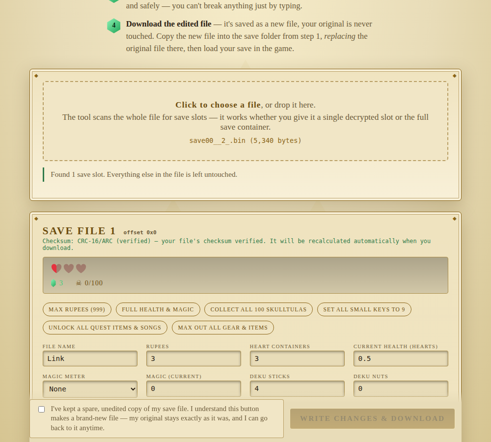
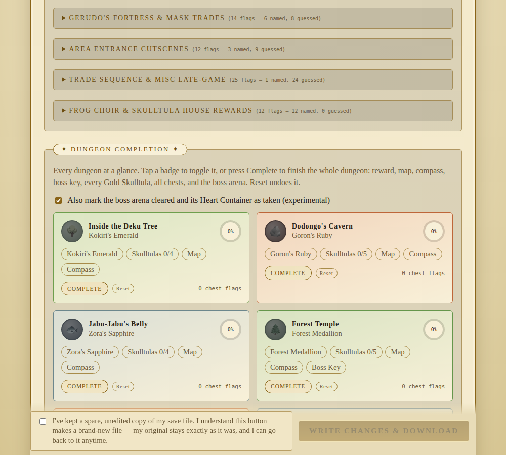
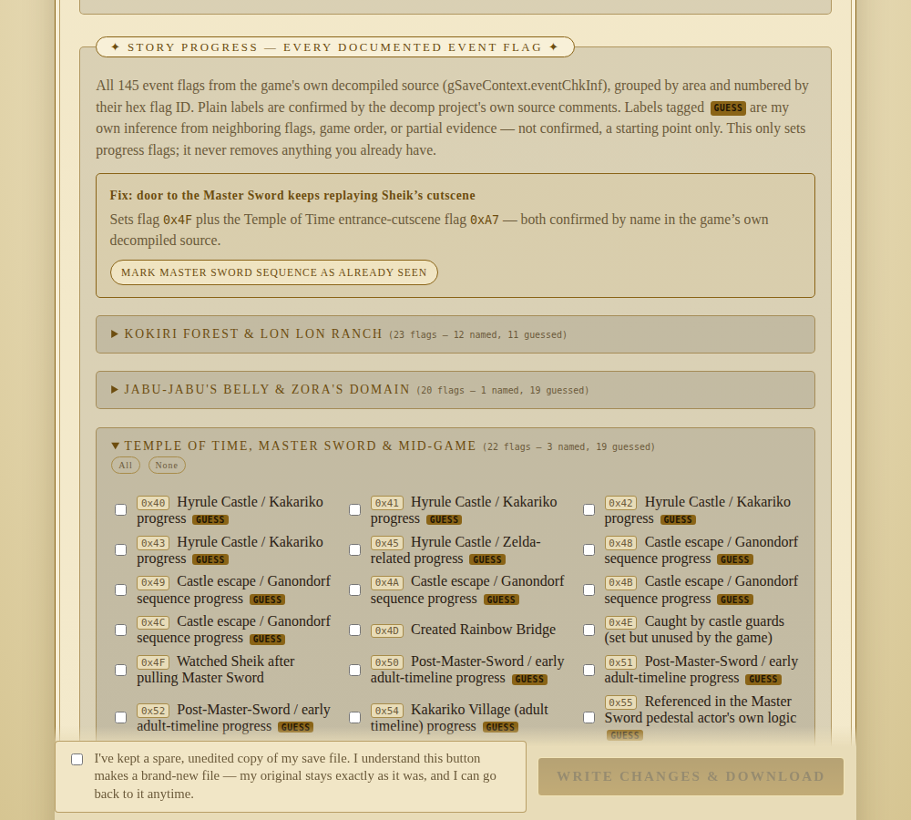

# OoT3D Save Editor

A save file editor for The Legend of Zelda: Ocarina of Time 3D, primarily designed for Android devices running the Azahar emulator, including devices like the AYN Thor. It also supports other setups that provide access to a raw save file. The editor runs in your browser or as an android app, and no files you load are ever uploaded anywhere.

## Features

- **Everything you'd expect**: rupees, hearts, magic, ammo, small keys, file name.
- **Full inventory editor**: all 24 item slots (including bottle contents and
  trade items), equipment, and every capacity upgrade.
- **Gold Skulltulas, individually** — not just a total count. Each of the 22
  in-game regions gets its own grid of tokens, sized to that region's real
  count (sourced from published token-count guides, cross-checked to sum to
  the documented totals).
- **Dungeon Completion panel** — one click to fully clear a dungeon: reward,
  map, compass, boss key, every Skulltula in it, all chests, and the boss
  arena.
- **Story Progress panel** — all 145 story/event flags from the game's own
  decompiled source, so you can skip cutscenes you've already seen or jump
  ahead in the story. See [Accuracy](#accuracy--the-guess-tags) below.
- **A real, verified checksum.** OoT3D validates each save file with a
  checksum before showing it in-game. This editor uses the actual algorithm
  (CRC-16/ARC over the full save, sourced from the original savedata-exploit
  tooling written by the people who reverse-engineered this file format) and
  recalculates it correctly on every save. Edited files load in-game.

This save format isn't officially documented by Nintendo. Everything here is
reverse-engineered, from a few different sources with different confidence
levels — I think it's more useful to be upfront about that than to present
guesses as facts:

- **Checksum**: verified directly against real save files. High confidence.
- **Core fields** (health, rupees, items, equipment, keys): sourced from a
  long-standing community save-format writeup, cross-checked against three
  real save files. High confidence.
- **Story/event flags**: sourced from the actual decompiled N64/3DS game
  source. About 40 of the 145 flags have a name and purpose confirmed
  directly in the source code's own comments (shown as plain text). The rest
  are tagged **GUESS** — my own inference from neighboring flags, the game's
  order of events, or partial evidence, clearly marked as unconfirmed rather
  than stated as fact.
- **A few things I couldn't verify**: exactly which bit maps to which named
  Gold Skulltula within a region (only the per-region total is confirmed),
  and the exact bit order for dungeon boss-key/compass/map flags (carried
  over from the N64 version's layout, not independently confirmed for 3DS).

**If you figure out what a GUESS flag actually does, open an issue** (there's
a template for it) with the flag number and what you observed — that's how
several flags already went from guesses to confirmed names.

## Credits

This tool wouldn't exist without the people who did the actual reverse
engineering:

- Save file offsets: the long-running community writeup at CloudModding's OoT3D
  save page, and the [OcarinaCTRComposer RAM Address Map](https://github.com/samaBR85/OcarinaCTRComposer/wiki/RAM-Address-Map).
- Checksum algorithm: `oot3d_savetool.c` from
  [smealum/oot3dhax](https://github.com/smealum/oot3dhax), written by the
  original savedata-exploit researchers.
- Story/event flag names: the [zeldaret/oot decompilation project](https://github.com/zeldaret/oot).

## License

MIT - see [LICENSE](LICENSE). This is an independent fan tool, not affiliated
with Nintendo. See the note at the bottom of the license file.
